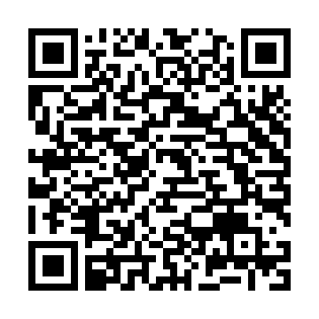

# Pokemon Randomizer: beta

**2.5.0 beta 1** is a test build of the next version. The stable version,
2.4.4, is on the [main page](https://github.com/ZIPender/pkmn-randomizer-3ds).

1. On your 3DS, open **FBI** › **Remote Install** › **Scan QR Code**.
2. Point the camera at this code. It always installs the newest beta, over
   the version you have: your settings and randomized games stay.
3. Start **Pokemon Randomizer** from the HOME Menu. The first screen says
   **Version 2.5.0 beta 1**.

No camera handy? Copy `pokemon-randomizer.cia` from the
[beta release](https://github.com/ZIPender/pkmn-randomizer-3ds/releases/tag/beta-latest)
to the SD card and install it with FBI. Use the CIA rather than the `.3dsx`:
the installed app gets more memory than the Homebrew Launcher one, and only
the installed app can put games on the HOME Menu.

## New in beta 1

- **Alternate forms** (General tab, on in every style). A Pokémon the
  randomizer places can come in any of its real forms: Alolan Vulpix,
  Rotom's appliances, Vivillon's patterns, East Sea Shellos... The Pokémon is
  picked first, then its form, so a Pokémon with many forms is no more
  common than one without. With *Similar strength*, only forms close to the
  usual stat total are used. Platinum and HeartGold/SoulSilver: trainers'
  Pokémon; Black/White and Black 2/White 2: wild and trainers' Pokémon; X to
  Ultra Moon: also legendaries, gifts and fossils. The spoiler log names each
  form, for example "Geodude (Alola)".
- **Double battles** (Customize › Trainers, off by default; Gen 3, 6 and 7).
  Every trainer battle becomes a double battle. A trainer with a single
  Pokémon gets a second one of the same level, marked "added for doubles" in
  the spoiler log. Partners who fight beside you, battle facilities and the
  games' own two-trainer battles stay as they are. In Ruby, Sapphire,
  Emerald, FireRed and LeafGreen a trainer fights you in a single battle
  while you have only one Pokémon able to fight, and your rival's first
  battle stays single. From X and Y on your one Pokémon faces both, and a
  Bulbasaur stands in your empty spot (in X, Y, Omega Ruby and Alpha
  Sapphire with a "Lv 999" box): a stand-in that never acts, and the battle
  ends when your last Pokémon faints. Not in Black, White, Black 2 and
  White 2 yet: there, one Pokémon against two froze the game in testing.
- **Special shops** (Customize › Items; *Shuffle* in Standard, *Random* in
  Chaos; [issue #7](https://github.com/ZIPender/pkmn-randomizer-3ds/issues/7)).
  What the special shops sell changes: the second clerk of a Poké Mart,
  department stores, markets. The clerk who sells Poké Balls and Potions
  never changes. *Evolution items for sale* (on) keeps every evolution stone
  and item buyable in some shop. The spoiler log lists every shop.
- **Totem Pokémon** (Sun, Moon, Ultra Sun, Ultra Moon; *Similar strength* in
  Casual and Standard, *Random* in Chaos;
  [issue #8](https://github.com/ZIPender/pkmn-randomizer-3ds/issues/8)).
  Each trial's Totem and the allies it calls become other Pokémon of the same
  level, with the moves those learn by then. They keep their aura and held
  item.
- **Fix: eShop Sun, Moon, Ultra Sun and Ultra Moon without their update.**
  The app read their game code wrongly: no TM, shiny or cheat changes, and
  their HOME Menu copy crashed at start (a black screen and an error on the
  Old 3DS XL of a player). If that happened to you, make the game again with
  this beta.
- A game made with an older version keeps its old content: make it again
  from its page, with the same seed and settings code. With the new options
  on, the same seed gives different trainers, shops and totems than 2.4.4.

## What to test

Tested before this beta, in emulators and on real dumps:

- Every game opens, randomizes and saves with each new option, in every
  style (about 390,000 automated checks on 35 game dumps, plus fault and
  memory tests).
- **Totems:** in Ultra Sun a randomized Totem showed its aura, used its
  ability and called a randomized ally.
- **Special shops:** Red, Emerald, Platinum and Sun showed the shop lists of
  the spoiler log, and an item could be bought; the Poké Ball and Potion
  clerk stayed the same.
- **Double battles:** Emerald and FireRed (single battle with one Pokémon,
  real double battle with two, rival kept single); Ultra Sun (one Pokémon
  against two, a loss sends you home as usual) and X (the same).
- **Alternate forms:** a trainer's Unown in Ultra Sun showed the form the
  spoiler log names.

Not yet seen in a game: the shops of the DS and 3DS games other than
Platinum and Sun, Totems in Sun and Moon, a won battle in Double battles,
the double battles of Ruby, Sapphire, LeafGreen, Y, Omega Ruby and Alpha
Sapphire, and forms outside Ultra Sun (wild Pokémon in the DS
games, legendaries and gifts on 3DS).
Feedback on those is the most useful. A freeze, a black screen or a
Pokémon that looks wrong in battle is worth a report.

Report what you see on the
[issues page](https://github.com/ZIPender/pkmn-randomizer-3ds/issues), with
**Options › Save a log file** turned on: your console, the game and where it
comes from, the settings code and seed, and the file
`sd:/3ds/pokemon-randomizer/logs/app.log`.

Unofficial fan project, not affiliated with Nintendo, Game Freak, Creatures
or The Pokémon Company. It contains no game data: use games you own.

The app includes curl, Mbed TLS and zlib for its update check: see
[THIRD_PARTY_NOTICES.md](THIRD_PARTY_NOTICES.md).
