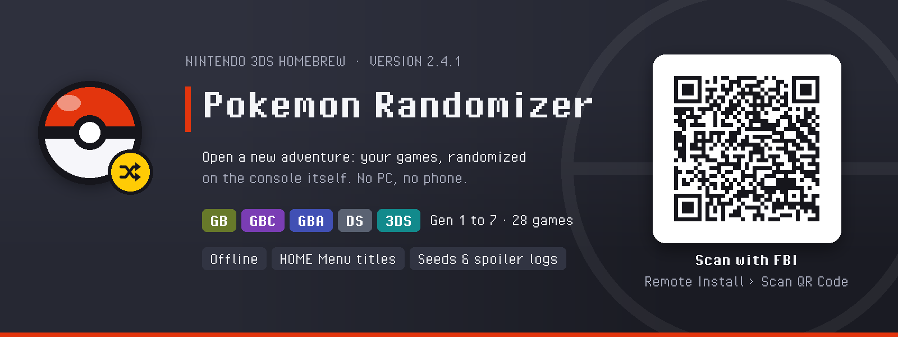
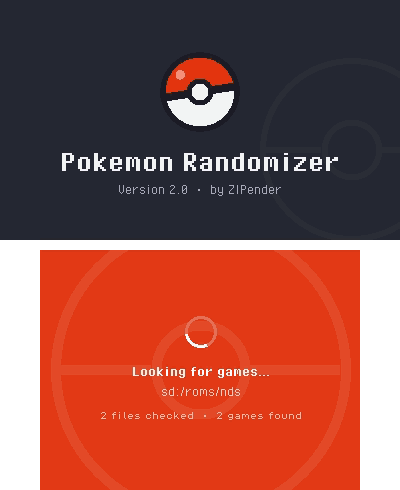
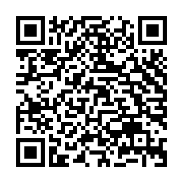
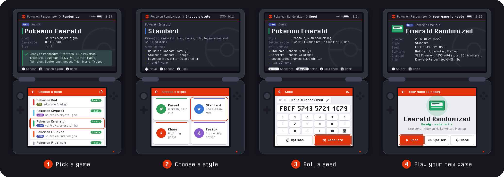

  

  <a href="https://github.com/ZIPender/pkmn-randomizer-3ds/releases/latest"><b>Latest release</b></a> ·
  <a href="#install">Install</a> ·
  <a href="#supported-games">Supported games</a> ·
  <a href="#how-it-works">How it works</a> ·
  <a href="https://github.com/ZIPender/pkmn-randomizer-3ds/issues">Report a bug</a>

https://github.com/user-attachments/assets/b636478c-fd76-4750-8825-a313927260f2

  

Pick one of your games, choose a style, and the 3DS builds a randomized copy:
new starters, wild Pokémon, trainers, moves, items and more. It works
offline, and your original game is never modified.

## Install

1. On your 3DS, open **FBI** › **Remote Install** › **Scan QR Code**.
2. Point the camera at this code. FBI downloads and installs the latest release.
3. Start **Pokemon Randomizer** from the HOME Menu.

No camera handy? Copy `pokemon-randomizer.cia` from the
[latest release](https://github.com/ZIPender/pkmn-randomizer-3ds/releases/latest)
to the SD card and install it with FBI, or copy `pokemon-randomizer.3dsx`
to `sd:/3ds/` for the Homebrew Launcher. Version 1.x is upgraded in place.

**You need:** a 3DS, 2DS or New 3DS with
[Luma3DS](https://3ds.hacks.guide), FBI, and your own legally dumped games
(ROM files, installed 3DS games or a game card).

## Supported games

| Gen | Games | You get |
| --- | --- | --- |
| 1 | Red, Blue, Yellow | `.gb`, and a HOME Menu icon that starts it in mGBA |
| 2 | Gold, Silver, Crystal | `.gbc`, and a HOME Menu icon that starts it in mGBA |
| 3 | Ruby, Sapphire, Emerald, FireRed, LeafGreen | `.gba`, and its own HOME Menu title (Virtual Console) |
| 4 | Diamond, Pearl, Platinum, HeartGold, SoulSilver | `.nds`, and a HOME Menu icon that starts it with nds-bootstrap |
| 5 | Black, White, Black 2, White 2 | `.nds`, and a HOME Menu icon that starts it with nds-bootstrap |
| 6 | X, Y, Omega Ruby, Alpha Sapphire | its own HOME Menu title, or a Luma3DS game patch |
| 7 | Sun, Moon, Ultra Sun, Ultra Moon | its own HOME Menu title, or a Luma3DS game patch |

At least one game of every generation was randomized and played on a New 3DS
XL. English releases are the tested ones; please report anything that goes
wrong.

## How it works

  

1. Put your ROM files (`.gb .gbc .gba .nds`, decrypted `.3ds/.cci/.cxi`) in
   `sd:/roms` or folders inside it. The app also looks at the SD card's root
   and the folders right under it (not system ones like `Nintendo 3DS`,
   `luma` or `3ds`). **Options › Scan folders** adds any other folder, or
   leaves one out with everything inside it. Installed 3DS games and the
   game card are found by themselves.
2. Tap **Randomize**, pick a game and a style: **Casual**, **Standard**,
   **Chaos**, or **Custom**, where the top screen explains every option.
   On a style, **Y** lists everything it changes and **X** starts Custom
   from it. Several copies or ROM hacks of one game? On the game list,
   press **Y** or tap the pencil to give each its own name: it stays on
   the SD card, even if you move the file.
3. Keep or roll a seed, then **Generate**. The same game, seed and settings
   code always give the same result, so you can race friends.
4. The game is saved in its own folder, like
   `sd:/3ds/pokemon-randomizer/randomized/Emerald-Randomized-U4DM/`, with its
   spoiler log (**Options › Randomized games folder** can change where, and
   its **+** makes a new folder). Open it from
   **Randomized games**: **How to play** says how to start it.

**What changes:** starters, wild Pokémon, trainers, legendaries and gifts,
in-game trades, stats, types, abilities, evolutions, moves and TMs, items
on the ground, and the shiny odds of wild Pokémon (Gen 2 to 7: pick a
preset or type your own, like 1 in 36), with a spoiler log for when you're
stuck. **Every family catchable** (Customize › Wild) gives the first form of
every evolution family a wild spot, so the whole Pokédex can be filled in one
game.

**Cheats** (Customize › Cheats), in every game: **Instant text** shows each
text box at once, battle text included (Standard and Chaos turn it on), and
**Starting items** puts what you pick in the bag of a new game, like 999 Rare
Candies for a Nuzlocke. Cheats are kept for each game and are not part of the
settings code.

**Updates:** the app checks GitHub for a new version when it starts and asks
before downloading it (turn it off in **Options › Check for updates**). It
works from version 2.1.0 on; older versions update with the QR code. After
an update, the app shows once what's new, and **Options › What's new** lists
every version's changes.

**The HOME Menu:** turn on **HOME** on the seed screen (or pick **Add to
HOME Menu** on the game's page) and the randomized game gets its own HOME
Menu icon, with the name you gave it. It needs the CIA build, started from
the HOME Menu. GB to DS games also get an animated banner with that name.

- **GB and GBC games** start in mGBA. Install its development build: in
  **Universal-Updater**, pick **mGBA** and install **"[git] mgba.cia"** (the
  stable mGBA can't open a game from another icon).
- **GBA games** become a Virtual Console title with its own save, in the
  3DS's own GBA mode (about a minute to install). Quit with **HOME**, then
  **A**: the save is written only then.
- **DS games** start with nds-bootstrap. Install the **"YANBF Forwarder
  Pack"** with **Universal-Updater**.
- **3DS games** become a full copy with their own save (about 50 minutes on
  a New 3DS XL). The quick way is **Activate in Luma**, which plays it
  through Luma3DS game patching with the original game's save, so back that
  save up with Checkpoint first.

Without the HOME Menu, GB, GBC and GBA games play in mGBA or any emulator;
DS games in TWiLight Menu++ or on a flashcart.

<b>Troubleshooting</b>

- **A game is missing:** check that the file is in `sd:/roms` (or at most two
  folders inside it), or add its folder in **Options › Scan folders** (and
  that it isn't in an excluded folder), and that it is a clean, decrypted
  dump, then press X on the game list.
- **FBI's QR install stalls at 0%:** your 3DS can't reach GitHub over HTTPS.
  Use the manual install.
- **"Something went wrong":** the dump looks modified or damaged. Your game
  was not changed; **View log** shows the details.

Report bugs on the [issues page](https://github.com/ZIPender/pkmn-randomizer-3ds/issues)
with the game and region, the seed and settings code, and what you saw.

## Disclaimer

Unofficial fan project, not affiliated with Nintendo, Game Freak, Creatures
or The Pokémon Company. It contains no game data: use games you own.

The app includes curl, Mbed TLS and zlib for its update check: see
[THIRD_PARTY_NOTICES.md](THIRD_PARTY_NOTICES.md).
