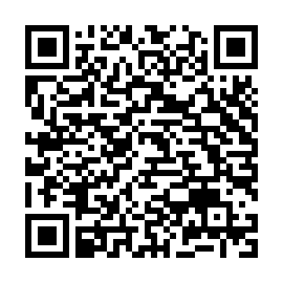

# Pokemon Randomizer: beta

**2.2.1 beta 1** is a test build of the next version. The stable version,
2.2.0, is on the [main page](https://github.com/ZIPender/pkmn-randomizer-3ds).

1. On your 3DS, open **FBI** › **Remote Install** › **Scan QR Code**.
2. Point the camera at this code. It always installs the newest beta, over
   the version you have: your settings and randomized games stay.
3. Start **Pokemon Randomizer** from the HOME Menu. The first screen says
   **Version 2.2.1 beta 1**.

No camera handy? Copy `pokemon-randomizer.cia` from the
[beta release](https://github.com/ZIPender/pkmn-randomizer-3ds/releases/tag/beta-latest)
to the SD card and install it with FBI. Use the CIA rather than the `.3dsx`:
the installed app gets more memory than the Homebrew Launcher one, and only
the installed app can put games on the HOME Menu.

## New in beta 1

- **New folders.** In **Options › Randomized games folder**, the **+** at the
  top right (or **X**) opens the keyboard: type a name and the folder is
  made where you are, then opened. Choose **Use this folder** to keep it.
  A name with `\ / : * ? " < > |` is refused, and a folder that is already
  there is just opened.

## What to test

- Make a folder with **+**, choose **Use this folder**, then randomize a
  game: it should land in the new folder.
- Try a name with a `/`, and the name of a folder that is already there.

Report what you see on the
[issues page](https://github.com/ZIPender/pkmn-randomizer-3ds/issues), with
**Options › Save a log file** turned on: your console, the game and where it
comes from, the settings code and seed, and the file
`sd:/3ds/pokemon-randomizer/logs/app.log`.

Unofficial fan project, not affiliated with Nintendo, Game Freak, Creatures
or The Pokémon Company. It contains no game data: use games you own.
